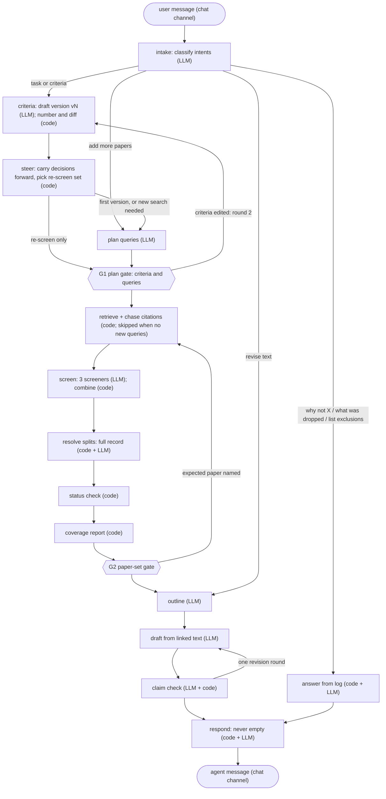

# Proposed agent: design

**Status:** draft v0.2, 22 Nov 2026, for team review. It becomes **v1** when the
open decisions marked "Phase 0" in §11 are settled and the shared models (§3.2)
are merged to main (target Nov 25).

**Scope:** the proposed literature-review agent that replaces the stub in
`harness/agents/proposed.py`, its interface, and how we compare it with the
baseline on the three existing cases. No code yet; sample input files are in
[design/samples/](design/samples/).

**Convention:** every unsettled point is marked **Open decision (ODn)**. All of
them are listed in §11 with a status, a recommendation, an owner and the phase
that needs the answer.

---

## 1. Goal and the breakdown-to-change table

**Goal.** Give the researcher real control over a literature review. They should
be able to see and change the criteria, approve what gets searched, inspect why
each paper was included or left out, change course without losing valid work,
and get the same answer when they ask again. The agent runs on the same cases,
corpus, tools, chat channel, metrics and agent model as the baseline. It must
not lose recall or report quality, and should cost at most about twice as much.

**Non-goals.** New search tools or live search (an optional Phase 4 extra).
Beating the baseline where it is already at its ceiling (case 1: recall 0.90,
trap flags 0.96). Changing the cases, personas, scripts or core metric names.

| Observed breakdown | Evidence | Change | Level |
|---|---|---|---|
| Opaque screening | Case 1: 5/5 (also case 2: 4/5)† | Screening record: criterion, quote and basis (snippet or full text) for every decision | Harness + Interface |
| Status ignored | Case 1: 2/5 | Status check on every included paper before approval | Harness |
| Missed key paper | Case 2: Dawes missed in 5/5 | Systematic citation chasing, plus a coverage report with an expected-paper check | Harness + Interface |
| Misattribution | Case 2: 2/5 | Drafting only from linked passages; a claim checker that knows confusable pairs | Harness + Model |
| Steering incomplete | Case 3 v1: 2/2 pilots never searched again after the narrowing; human run: re-search cut off by the tool limit (no flag fired)† | Versioned criteria; a change triggers re-search and partial re-screening; show what was added and dropped | Harness + Interface |
| Not reproducible | Case 3: first maps overlapped 0.42 | Approved, logged queries; a search snapshot; reruns from the log | Governance |
| Empty answer at tool limit | Case 3 run 4 (turn 1); case 1 runs 1 and 4 (turn 2)† | Budget-aware turns that always return partial results plus a note of what's left | Harness |
| Scope drift unflagged | Human run: telepresence | Category labels on every paper; out-of-scope categories flagged | Interface |
| Unverifiable drops | Human run, turn 3 | "What I dropped and why" answered from the log | Governance |

† Evidence cell changed after checking the run files. No rows were added or removed.

### Evidence check (run files, 22 Nov 2026)

| Row | What the run files show | Verdict |
|---|---|---|
| Opaque screening | `bd_opaque_screening` = 1 in all 5 case 1 runs, and in case 2 runs 1–4 | Correct; case 2 added as supporting evidence |
| Status ignored | Case 1 runs 4 and 5 (Pott-Junior 2021, Samaha 2021). Neither run ever saw the retraction notice in a tool result | Correct |
| Missed key paper | Dawes 1989 (`W2012218966`) is in no final `included_ids` and in no tool result in any of the 5 runs. All 5 runs made **0** `get_references` calls | Correct |
| Misattribution | Case 2 runs 3 and 5: 3 "misattributed" labels among 115 pair claims (one sentence was repeated in run 3). The hand-check in `pair_claims_review.md` is **0/115** done | Correct, but the labels aren't verified yet (§7.7) |
| Steering incomplete | **Weakest row.** v1 pilots: 0 tool calls after the narrowing, and `post_change_recall` 0.48 and 0.45, computed afterwards. But v1's message asked only to refilter, not to add papers. Final v2 runs: `bd_steer_incomplete` 0/5 and `bd_cant_steer` 0/4. Human run: `steer_preservation` 1.0 and `post_change_recall` 0.69, so no flag. Its turn-2 re-search hit the 40-call cap with 3 records unopened (one of them, `W1178530349`, is in the post-change set), and in turn 3 the agent admits it applied the filter unevenly | Qualified as shown; no final run shows this breakdown |
| Not reproducible | First-map Jaccard 0.419 over runs 1, 2, 3 and 5 (run 4 had no first map). Final maps: 0.585, or 0.72 without run 4 | Correct |
| Empty answer at tool limit | Empty agent messages: case 3 run 4 turn 1, **and case 1 runs 1 and 4 turn 2**. Each came right after a turn used all 40 calls. 10 turns across the 16 baseline runs hit the cap. Case 1's DOC.md doesn't mention its two empty replies (the scripted turn 3 went out anyway) | Corrected: 3 of 15 sim runs |
| Scope drift unflagged | The first map listed 4 off-scope telepresence papers (4/48 = 8%, below the 0.2 threshold, so `bd_scope_drift` = 0) without flagging them. The agent conceded this only when asked in turn 4, and 1 of them stayed in the final map | Correct |
| Unverifiable drops | Turn 3 made 0 tool calls. The answer was rebuilt from the conversation, and it says turn 2's drop list was incomplete | Correct |

**About the human run.** The only human run (case 3,
`runs/case3_field_map/baseline/human/20261120T004451Z_1`) is the **video
recording run** for the case 3 test video linked in the README. It was not a
study session (OD19). Its survey is incomplete (0 of 8 Likert items, 3 of 5 TLX
scales) and its interview notes are an empty template, so it is not survey
data. Every human-run cell above rests on the transcript alone.

Three rows (steering, scope drift, drops) have no flag that fired in the sim
runs, so the sim comparison needs new metrics to show them (§7.2).

### Success targets (OD18, to freeze with v1)

| Measure (sim, 5 runs per case) | Baseline | Target |
|---|---|---|
| `bd_opaque_screening`, case 1 | 5/5 | ≤ 1/5 |
| `bd_status_ignored`, case 1 | 2/5 | 0/5 |
| Dawes 1989 in the final section, case 2 | 0/5 | ≥ 4/5 |
| `bd_misattribution`, case 2 | 2/5 | 0/5 |
| Empty replies | 3 of 15 runs | 0 |
| First-map overlap, case 3 | 0.42 | ≥ 0.6 |
| `post_change_recall`, case 3 | 0.70 (0.62–0.76) | ≥ 0.70 (at least the baseline's) |
| `drop_list_f1`, case 3 (new) | not measured | ≥ 0.9 |
| Gate interactions per run (`gate_rounds`, mean per case) | 0 | ≤ ~8 |
| `recall_gold`, `claim_support_rate` | per case | no more than 0.05 below the baseline |
| Cost per sim run | per case | ≤ 2× the baseline (at risk for cases 2 and 3, §9) |

Case 1 and 2 baselines used Opus 5.5. The targets are recomputed if those
baselines are rerun on Sonnet (OD1).

---

## 2. Architecture

### 2.1 Shape

There is one LangGraph `StateGraph` per run, and one user turn is one pass from
`intake` to `respond`. **LLM nodes return JSON against a schema and never call
tools. Code nodes call the four mock-search tools,** through a harness wrapper
that records and budgets every call. So every tool call is an approved, logged,
budgeted action, and the model layer needs no tool-calling support, which keeps
providers swappable (§6).



Not drawn:
- Every tool call goes through the budgeted tool wrapper (§3.6).
- Every node appends to `log.jsonl` (§4.6).
- When the budget reaches its reserve, any node routes straight to `respond` (§4.5).

### 2.2 Nodes

| Node | Kind | Tools | Does | Table rows |
|---|---|---|---|---|
| `intake` | LLM | – | Splits the message into intents (§2.6); extracts criteria statements and paper references | all |
| `criteria` | LLM + code | – | LLM drafts the next criteria version from the user's words; code numbers it and diffs it against its parent | Steering, Opaque screening |
| `steer` | code | – | Carries forward decisions the change doesn't affect, queues the rest for re-screening, decides whether to search again | Steering, Drops |
| `plan_queries` | LLM | – | Proposes queries per criteria facet, with a purpose and a budget split | Not reproducible, Missed key paper |
| `retrieve` | code | `search_papers`, `get_references`, `get_citations` | Runs approved queries; dedupes; records `total_matches` and truncation; chases citations | Missed key paper, Not reproducible |
| `screen` | 3× LLM + code | – | Three screeners per batch of 25; code checks quotes and combines verdicts | Opaque screening, Scope drift |
| `resolve` | code + LLM | `get_paper` | Opens full records for split votes and title-only candidates, then screens them once more | Opaque screening |
| `status` | code | `search_papers`, `get_citations` | Notice sweep, preprint check, per-paper citations as the budget allows | Status ignored |
| `coverage` | code | – | Coverage report and expected-paper check (§4.1) | Missed key paper |
| `outline` | LLM + code | – | Proposes sections with assigned papers; code checks that every approved paper is placed or listed as not discussed | Misattribution |
| `draft` | LLM + code | – | Writes from linked text only; code rejects ids outside the approved set and claims with no link | Misattribution |
| `claim_check` | LLM + code | – | Checks each claim against its linked text and its confusable neighbours | Misattribution |
| `answer_from_log` | code + LLM | `search_papers`, `get_paper` (only for a paper never seen) | Answers "why not X", "what did you drop" and "list exclusions" from log entries | Opaque screening, Drops |
| `respond` | code + LLM | – | Writes the turn's reply; never empty; includes what's left when the budget ran out | Empty answer |

### 2.3 State

| Field | Contents | Written by |
|---|---|---|
| `criteria` | list of CriteriaVersion, plus the active version | `criteria`, G1 |
| `queries` | list of Query | `plan_queries`, G1, `retrieve` |
| `papers` | id → PaperView (only what tools returned) | `retrieve`, `resolve` |
| `decisions` | list of Decision (append-only) | `screen`, `resolve`, `steer`, G2 |
| `status` | id → StatusCheck | `status` |
| `paper_sets` | list of PaperSetVersion | G2 |
| `coverage` | latest CoverageReport | `coverage` |
| `outline`, `claims` | Outline; list of Claim | `outline`, `draft`, `claim_check` |
| `budget` | BudgetState for the current user turn | tool wrapper |
| `turn`, `messages` | user turn number; chat history | `intake`, `respond` |
| `pending_gate` | Gate or null | gate nodes |

The state can always be rebuilt from `log.jsonl`. A test replays the log and
compares the result with the checkpointed state after every node.

### 2.4 Gates and checkpoints

- **Two gates.**
  - **G1, the plan gate:** a new criteria version and/or new queries, in one
    card. Either part can be empty.
  - **G2, the paper-set gate.**

  The criteria and query gates are merged so that a run stays within the
  gate-burden target (§1).
- **How a gate runs.** A gate node builds a Gate (§3.3), logs `gate_request`
  and calls LangGraph `interrupt(gate)`. `ProposedAgent.respond()` runs the
  graph. On each interrupt it calls the bound user's `answer_gate(gate)` and
  resumes with `Command(resume=response)`. It returns once `respond` finishes.
- **Gates live inside a user turn.** They don't use up one of the 6 user turns
  (OD3), and the sim script still fires on turn numbers.
- **When each gate opens:**
  - G1, whenever a new criteria version or new queries are proposed;
  - G2, before drafting, whenever the paper set changed since its last
    approval;
  - a one-item G2, when a "why not X" check finds X eligible ("Add X to the
    set?").
- **Limits:** at most 2 gates per user turn and 2 rounds per gate. After
  round 2 the edited proposal counts as approved, logged as `auto_after_rounds`.
- **Expected burden** without edits: about 6–7 gate interactions in a case 1
  run (G1 and G2 in each of turns 1–3, plus at most one why-not gate), and
  about 4 in cases 2 and 3.
- **Checkpointer:** LangGraph's SQLite checkpointer at
  `<run_dir>/checkpoints.sqlite`, with the run folder name as the thread id. It
  handles interrupt/resume and crash recovery within a run. It is a cache, not
  the record (`log.jsonl` is), so it is gitignored.

### 2.5 What the agent proposes and what code decides

| Decision | LLM proposes | User approves at | Code decides or enforces |
|---|---|---|---|
| Criteria | Wording, fields, categories and whether each is in scope | G1 | Version numbers, diffs, lock. Every decision points to a version |
| Queries | Text, facet, purpose, budget split | G1 | Runs only approved queries, in order; logs results; stops at the budget |
| Candidates | – | – | Union of query results and citation lists; dedupe by id; flags near-duplicate titles |
| Per-paper verdict | Each screener's verdict, deciding criterion, quote, basis and category | – | The quote must appear verbatim in the text seen at the stated basis; otherwise one retry, then `unsure` |
| Combined verdict | – | G2 (any paper can be moved) | Unanimous → final. 2–1 → `resolve`. Still split, or no budget left → `unsure`, shown at G2 |
| Publication status | – | G2 | Detects notices and superseded preprints; a paper with a notice is never included without a flag |
| Scope | A category for each paper | G1 (scope of each category), G2 | A paper in an out-of-scope category never enters the main map; it is listed separately |
| Paper set | – | G2 | Frozen as a PaperSetVersion; drafting reads only this set |
| Report text | Outline and sentences | – | Approved ids and linked text only; claim checks; drops claims that can't be fixed |
| Answers about decisions | Wording | – | Built from log entries; every id the answer names must have a log entry |
| Budget | – | Sees the plan at G1 | Hard cap per user turn, with a reserve for the reply |

### 2.6 Turn routing

| Intent | Examples in the cases | Route |
|---|---|---|
| `task` | Every turn 1; "add any relevant ones you missed" | criteria → plan → G1 → retrieve → screen → status → G2 → draft → respond |
| `criteria` | Case 1 turns 2–3; case 2 turn 2; case 3 turn 2 | criteria → steer → (plan, if re-search is needed) → G1 → re-screen and screen new candidates → G2 → draft → respond |
| `why_not` | Case 1 turn 4; case 2 turn 3 | answer_from_log. If the paper was never seen, search for it and screen it now, and say so; if it qualifies, a one-item G2 → respond |
| `list_decisions` | Case 1 turn 5; case 3 turn 3 | answer_from_log → respond |
| `revise_text` | Case 2 turns 4–5 | outline / draft / claim_check on the current set → respond |
| `other` | Thanks, clarifications | respond |

One message can carry several intents. `intake` orders them, criteria first.
For example, case 1 turn 2 gives criteria and asks for the updated list.

---

## 3. Interfaces and contracts

This section freezes in v1. After that, any change to it goes in its own pull
request, reviewed by all three of us.

### 3.1 Channel and recorder changes

These are the only changes to the shared harness:

- **`User.answer_gate(gate) -> GateResponse`** is a new method. SimUser answers
  with an LLM plus rules (§3.5), HumanUser with a terminal menu, and
  StreamlitUser with gate cards (§3.4).
- **`Agent.bind_user(answer_gate)`** is called once by `run_conversation`
  before turn 1. It does nothing for the baseline. The baseline's behaviour,
  prompt and recorded events don't change. We check this by re-running the
  stored baseline tool calls and replaying their scores, the same check case 2
  used for its harness changes (`cases/case2_related_work/NEEDED_CHANGES.md`).
- **One shared run function.** `harness.run` is refactored so the terminal
  entry point and the Streamlit app call the same function. Output folders,
  `config.json` and the survey are therefore identical in both.
- **Recorder.** Two new events: `gate_request` and `gate_response` (with
  `latency_s` and `responder`). Every mock-search call that code makes is
  recorded as the same `tool_call` / `tool_result` events the baseline writes,
  so the metrics' "what the agent saw" reconstruction works unchanged.
- **SimUser** keeps gates and its answers in its transcript. Gates never advance
  its script counter.
- **`config.json`** gains `provider`, `proposed_prompts_sha256`,
  `sim_gate_rules_sha256`, `budget_plan`, `langgraph_version`, `freeze_tag`,
  and `effort: "api_default"` (OD7). Existing fields are unchanged.
- **`reward.json`** keeps its core keys. New metrics go under `extra_metrics`
  for both agents (§7.2), next to the existing `case_metrics`.

### 3.2 Shared data models

These are Pydantic v2 models in `harness/contracts/`, with JSON Schemas exported
to `harness/contracts/schemas/` for the interface and the gate validator.
**No model carries ground truth** (status, labels or `hidden_from_search`).

**PaperView**: what the agent knows about a paper.

| Field | Type | Notes |
|---|---|---|
| `id`, `title`, `year`, `venue`, `authors`, `doi` | from tools | |
| `seen_level` | `title` / `snippet` / `full` | the highest level seen; set by code |
| `seen_text` | `{title, snippet?, passages?: [{pid, section, text}]}` | exactly what the tools returned |
| `found_by` | list of log seq | the queries or citation lists that surfaced it |
| `n_citations` | int or null | from `get_paper` |
| `preprint_like` | bool | set by code: the venue names a preprint server |
| `category_id` | str or null | from screening |

**CriteriaVersion**

| Field | Type | Notes |
|---|---|---|
| `version`, `parent` | int, int or null | |
| `created_turn`, `source_seq` | int, int | the user message or gate response it came from |
| `criteria` | list of `{id: "C1", kind: include/exclude, field, text, checkable_at: snippet/full}` | `field` is one of design, population, intervention, comparator, outcome, date, status, scope, other |
| `categories` | list of `{id: "K1", label, in_scope}` | topical scope labels for every paper |
| `diff` | `{added, removed, changed}` | criterion and category ids; computed by code |
| `approved_by` | gate id or null | |

**Query**

| Field | Type | Notes |
|---|---|---|
| `id`, `text`, `year_from`, `limit` | | `limit` ≤ 50 |
| `purpose` | `facet:<field>` / `re-search` / `status` / `expected-paper` | |
| `criteria_version`, `proposed_by` | int, agent/user | |
| `state` | `proposed` → `approved` / `edited` / `removed` → `run` | |
| `result` | `{ids, total_matches, returned, truncated}` | `truncated` = `total_matches` > `returned` |

**Decision**: append-only. The latest decision per paper and criteria version
wins.

| Field | Type | Notes |
|---|---|---|
| `id`, `paper_id`, `criteria_version` | | |
| `actor` | `screener:A/B/C`, `resolver`, `combiner`, `status`, `carried`, `user` | |
| `verdict` | `include` / `exclude` / `unsure` | |
| `criterion_id` | str or null | required for `exclude` |
| `quote` | str, ≤ 40 words | verbatim from `seen_text` |
| `basis` | `title` / `snippet` / `full` | where the quote came from |
| `quote_verified` | bool | set by code |
| `category_id`, `rationale` | str, str (≤ 25 words) | |
| `votes` | `{A, B, C}` | combiner only |
| `carried_from`, `supersedes` | decision id or null | steering and user moves |

**StatusCheck**

| Field | Type | Notes |
|---|---|---|
| `paper_id`, `checked_turn` | | |
| `result` | `no_notice_found` / `sweep_only` / `retraction` / `withdrawal` / `expression_of_concern` / `superseded` / `unchecked` | `no_notice_found` needs a per-paper check; `sweep_only` means only the notice sweep covered it |
| `evidence_id` | id of the notice or journal version, or null | |
| `method` | `notice_sweep` / `get_citations` / `title_search` | |

**PaperSetVersion**: `version`, `criteria_version`, `included`, `unsure`,
`excluded_count`, `approved_by`.

**Claim**

| Field | Type | Notes |
|---|---|---|
| `id`, `section_id`, `sentence` | | |
| `cited_ids` | list | must be in the approved set |
| `evidence` | list of `{paper_id, pid or "snippet", text}` | the linked text the drafter used |
| `check` | `{verdict, correct_id, compared_with, rationale}` | `verdict` is supported, unsupported, misattributed or not_a_claim |
| `revision`, `outcome` | int; `kept` / `rewritten` / `removed` | |

**LogEntry**: one line of `<run_dir>/log.jsonl`.

| Field | Type | Notes |
|---|---|---|
| `seq`, `ts`, `turn` | | `seq` increases monotonically |
| `kind` | `user_message`, `agent_message`, `criteria_version`, `query`, `gate_request`, `gate_response`, `tool_call`, `tool_result`, `decision`, `status_check`, `coverage_report`, `paper_set`, `outline`, `claim`, `budget`, `error` | |
| `actor` | `node:<name>`, `code:<name>`, `user`, `sim_user` | |
| `payload` | one of the models above | tool results are stored as ids plus a sha256 of the content |
| `prev_sha256` | hash of the previous line | a tamper-evident chain (stretch, §4.6) |
| `usage` | model and token counts | LLM entries only |

### 3.3 Gate message format (over the existing chat channel)

**Gate**

| Field | Notes |
|---|---|
| `gate_id` | `g<kind>-t<turn>-r<round>`, e.g. `gplan-t1-r1` |
| `kind` | `plan` / `paper_set` |
| `turn`, `round`, `criteria_version` | |
| `title` | one line saying what is being decided |
| `text` | the canonical plain-text rendering (rules below) |
| `items` | a flat, numbered list. Plan: `criterion`, `category` and `query` items. Paper set: `paper` items with group, verdict, criterion, quote, basis, category, status and votes |
| `coverage` | `paper_set` only (§4.1) |
| `allowed_actions` | `approve`, `edit` |
| `edit_ops` | plan: `edit_criterion`, `add_criterion`, `remove_criterion`, `set_scope`, `edit_query`, `add_query`, `remove_query`. Paper set: `move`, `expect_paper`, `set_scope` |
| `budget` | `{cap, used, planned}`, plus the split on plan gates |

**GateResponse:** `gate_id`, `action`, `edits` (a list of `{op, target,
value}`), `note` (at most one sentence), `responder` (`sim`, `human` or
`auto`), `latency_s`.

**Text rendering rules.** The same text goes to the sim user, the terminal and
the Streamlit "view as text".
1. Line 1 is the title. Line 2 says what happens on approval.
2. Every item is numbered and names its id, for example: `[T009] Retrieval
   practice in middle school science classrooms (2020) · K-12 study · C1 ·
   snippet: "Seventh- and eighth-grade science students"`.
3. A paper-set gate lists these in full: included papers, papers that need the
   user's call, screener splits, status flags and out-of-scope papers. Excluded
   papers are grouped by criterion, with counts and the first 5 of each. The
   full list is in `items`, and in the terminal through `/show excludes`.
4. At most 60 lines. It ends with the allowed replies.
5. No ground truth and no metric names.

Full examples: [design/samples/gate_messages.json](design/samples/gate_messages.json),
rendered as [gate_plan.txt](design/samples/gate_plan.txt) and
[gate_paper_set.txt](design/samples/gate_paper_set.txt).

### 3.4 How the interface renders gates (Streamlit, OD12)

- **App and channel.** `harness/ui/app.py` runs the shared run function (§3.1)
  in a background thread with a `StreamlitUser`. Its `next_message` and
  `answer_gate` block on a queue that the page fills. The page polls the
  outgoing queue on a short timer and re-renders, since Streamlit re-runs the
  script on every interaction.
- **Chat:** `st.chat_message` and `st.chat_input`.
- **G1 (plan card):** the criteria editor and query-approval card as
  `st.data_editor` tables (editable text, kind and in-scope columns; add and
  delete rows).
- **G2 (review queue):** an `st.data_editor` table with an editable verdict
  column for moves, a text input for an expected paper, and the coverage report
  in an expander.
- **On every card:** "view as text" shows `text` in an `st.expander`. Only
  `allowed_actions` and `edit_ops` are offered, and each edit becomes one
  `GateResponse` op. Latency runs from when the card renders to when it is
  submitted.
- **Survey.** After `/done`, the survey runs as an `st.form` that writes the
  same `survey.json` as the terminal survey.
- **One participant session per server process.** The agent can't tell
  StreamlitUser, HumanUser and SimUser apart; only `responder` is recorded.

### 3.5 Simulated-user gate rules (draft; freeze before final runs)

These go in `shared/sim_gate_rules.md`, and their sha256 is recorded in
`config.json`. **No `persona.md` changes**, because the personas are part of the
frozen cases. Changing the rules after the freeze means rerunning every proposed
run.

- **SG1.** Reply only with the gate's allowed actions and edit ops. The note is
  at most one sentence.
- **SG2.** Use only your persona and what has already appeared in the
  conversation, including earlier gates. **Never reveal what your script sends
  in a later message.** For example, case 1's second criteria message must not
  leak at the turn-1 plan gate. This keeps the information schedule the same as
  the baseline's.
- **SG3 (plan gate, criteria part).** Approve if the criteria match what you
  have said. Otherwise, edit only to restate what you have said. Never add a
  criterion you haven't stated. Mark a category in or out of scope only if your
  persona's scope statement decides it.
- **SG4 (plan gate, searches part).** Approve. You may remove a search that is
  clearly outside your stated scope. Never add searches.
- **SG5 (paper-set gate).** Approve, except that you may move a paper (at most
  3 per gate) when the gate itself shows a reason grounded in your criteria (a
  status flag, an out-of-scope category) that contradicts the proposed verdict.
  On a one-item "Add X?" gate, approve if the shown reason meets your criteria.
  Name an expected paper only if your persona names it; otherwise say none.
- **SG6.** At most 2 rounds per gate; approve in round 2.
- **SG7.** No meta questions about the tool, database or search methods (as in
  `persona.md`).
- **SG8.** Gate answers don't advance your script. Your next chat message is
  still the next scripted one.

**Mechanics.** One LLM call returns a schema-valid GateResponse. Code then
validates it: the ops are allowed, the ids appear in the gate, and SG5 and SG6
hold. An invalid answer becomes `approve`, logged as `fallback`. The optional
ablation A1 replaces all of this with "always approve" (§7.6). OD4 covers the
alternative of rules only.

### 3.6 Tool and budget contract

- **Tools only.** The proposed agent gets one object from the harness,
  `BudgetedTools`: the four mock-search functions with the signatures in
  `TOOL_DEFS`. It gets no access to `cases/`. A unit test fails if
  `harness/agents/proposed/` mentions `cases/`, `case.yaml`, `papers.jsonl` or
  `labels.json`.
- **One cap for all calls.** Every executed call counts against the
  per-user-turn cap of 40, whether an LLM or code asked for it (OD2). The
  harness, not the agent, enforces the cap and raises `BudgetExhausted`.
- **Budget API.** The agent plans with `budget.remaining()` and
  `budget.reserve`.

### 3.7 Sample input files

These are in [design/samples/](design/samples/), with a README. All ids come
from the synthetic `_toy` case, so nobody tunes against the test cases. Text
and quotes are verbatim from the toy corpus, and the search results are the
mock tool's real output.

| File | Module (owner) | Shows |
|---|---|---|
| `retrieval_input.json` | Retrieval (Bhanu) | Approved queries, the budget split, citation-chasing and status settings |
| `screening_input.json` → `screening_output.json` | Screening (Vishwani) | One batch: an include, two excludes and a title-only `unsure` |
| `steering_input.json` → `steering_output.json` | Steering (Bhanu) | A narrowing change: re-screen set; kept, dropped and unsure papers; carried decisions; no re-search |
| `synthesis_input.json` → `claim_check_output.json` | Synthesis (Bhanu), claim checker (Vishwani) | Outline, linked passages, a confusable preprint; one supported and one misattributed claim |
| `gate_messages.json`, `gate_plan.txt`, `gate_paper_set.txt` | Interface (Wendi), gate rules (Vishwani) | A plan gate and a paper-set gate with full items, coverage and budget; sim and human responses |
| `log_excerpt.jsonl` | Log (Bhanu) | Query, decision, gate-response and budget entries |

---

## 4. Components

**Must-have** means needed for the Phase 3 comparison and built first.
**Stretch** means built only after the must-haves work on a dev case. A
must-have is never cut to make room for a stretch item.

### 4.1 Retrieval
*Rows: Missed key paper, Not reproducible, Status ignored.*

**Must-have**
- **Logged, approved queries.** 6–12 per plan, each tagged with a criteria
  facet and a purpose. They run in a fixed order with `limit` 50, and results
  are logged with `total_matches` and a truncation flag. A truncated query is
  shown in the coverage report, never dropped silently.
- **Search snapshot.** The logged result lists plus `corpus_sha256`. A rerun
  from the log must reproduce every list exactly (§4.6).
- **Systematic citation chasing.** After the first screening pass, seeds are
  the included papers, ranked first by how many other included papers cite them
  and then by `n_citations`. Up to `max_seeds` (4–6, depending on budget) get
  `get_references`, and the top 2 also get `get_citations`. New ids are
  screened at title level, and any include or unsure goes to `resolve`. All 5
  case 2 baseline runs made no `get_references` call, while 42 searchable papers
  cite Dawes 1989.
- **Expected-paper check (code).** For every reference list fetched, code
  counts how many included papers cite each id. Any id cited by at least
  `expected_paper_min_citers` included papers that isn't included goes on a
  "frequently cited, not included" list, with its decision or "not screened".
- **Status check,** before G2, for every included paper:
  1. a notice sweep: 1–3 searches pairing "retraction", "withdrawal" and
     "expression of concern" with topic words, with notice titles matched to
     included titles by code;
  2. a preprint check: one title search for each preprint-like included paper.
     Title token Jaccard ≥ 0.6 plus a shared first author means superseded;
  3. `get_citations` per included paper while the budget lasts, because notices
     cite the paper they retract.

  Each paper is shown at G2 and in the report as checked (`no_notice_found`),
  `sweep_only`, flagged or `unchecked`. A notice found means exclusion under a
  status criterion if there is one; otherwise the paper is kept with a visible
  flag.
- **Coverage report.** It shows:
  - queries, and which were truncated;
  - candidates by seen level;
  - screening counts by verdict and basis;
  - status coverage;
  - seeds chased and the new papers they found;
  - the frequently-cited-not-included list;
  - work left undone.

  It appears as text at G2 and, summarized, in the report's appendix.

**Stretch**
- Proposing a narrower split for each truncated query.
- Looking up papers the user names at G2 (`expect_paper`), by title and author,
  then in the reference lists already fetched.
- LLM confirmation of borderline preprint matches (Jaccard 0.4–0.6). Without
  it, these are shown at G2 as "possible journal version".

### 4.2 Screening
*Rows: Opaque screening, Scope drift unflagged (and Status ignored, through status decisions).*

**Must-have**
- **Three screeners on the same model (OD5).**
  - A checks the criteria strictly.
  - B is recall-oriented: it excludes only with explicit evidence.
  - C uses A's prompt with the candidates in a different seeded order.

  Each returns a verdict, the deciding criterion, a verbatim quote, the basis, a
  category and a rationale of at most 25 words.
- **Code checks.**
  - The quote appears verbatim (whitespace and case normalized) in the text
    seen at the stated basis.
  - The criterion and category ids exist.
  - Every exclusion names a criterion.

  If a check fails, the screener gets one retry, and the paper then becomes
  `unsure`.
- **Combining (code).** A unanimous verdict is final. A 2–1 split goes to
  `resolve`, which opens the full record and screens once more; if it is still
  split, or there is no budget, the paper is `unsure` at G2. A title-only
  candidate never gets a final verdict without a snippet or the full record.
- **Adaptive sampling (OD6).** A screens everything. B and C screen A's
  includes and unsures plus a fixed-seed 20% of A's excludes. If B or C
  disagrees on a sampled exclude, the whole batch gets B and C. It is a
  must-have because it saves about $0.3 per run (§9).
- **Batching.** 25 candidates per call, with the system prompt and criteria
  version as a cached prefix.
- **Screening record and answers from it.** "Why not X" and "list exclusions"
  are rendered from the logged decisions. So every reason is grounded (quote
  verified), accurate about the process (from the log) and states its basis:
  the three conditions `bd_opaque_screening` checks. For a paper the agent
  never saw, the answer says so, then searches for it and screens it on the
  spot. Case 1's why-answers failed on exactly this in 4 of 5 runs.
- **Scope labels.** Every paper gets one topical category from the version's
  list. Papers in out-of-scope categories appear under "Outside your scope" at
  G2 and never enter the main map. In the human run, 4 telepresence papers sat
  in the first map unflagged until the user asked in turn 4.

**Stretch**
- Agreement statistics (A against B/C) per run.

### 4.3 Steering
*Rows: Steering incomplete, Unverifiable drops.*

**Must-have**
- **Versioning.** A criteria change creates version n+1 with a diff computed by
  code, approved at G1.
- **Partial re-screen.** Code picks the set:
  1. every paper included under version n, screened only against added or
     changed criteria;
  2. excluded papers whose deciding criterion was removed or relaxed, screened
     in full;
  3. everything else, carried forward with `carried_from`.

  The same three screeners and adaptive rule apply.
- **Re-search.** If the change adds or narrows a facet, or the user asks for
  missed papers, `plan_queries` proposes facet queries for the new version, in
  the same G1. New candidates are screened under version n+1. The case 3 v1
  baseline only refiltered, and the human run's re-search ran out of budget
  with 3 records unopened. The budget plan therefore reserves calls for this.
- **Diff.** Kept, dropped (with criterion, quote and basis), added (with the
  query or citation that found it) and unsure papers, all computed from the
  decisions. It appears in the reply, and "what did you drop" is answered from
  it.

**Stretch**
- Reverting to an earlier criteria version. Decisions are never deleted, so
  this needs no new data, only a command and a UI control.

### 4.4 Synthesis
*Row: Misattribution (and claim support).*

**Must-have**
- **Outline.** Sections with assigned papers. Every approved paper is placed or
  listed as "not discussed". No gate (OD8).
- **Draft.** Each section is written only from the seen text of its papers
  (snippets or passages). The output is sentences, each with cited ids and
  evidence references (a passage id, or `snippet`). Code rejects ids outside
  the approved set and claims without evidence.
- **Confusable neighbours,** computed by code and **never read from
  `case.yaml`**: papers with the same first author, the 2 most similar papers
  by title and abstract (BM25) in the approved set, and preprint–journal pairs,
  including excluded versions.
- **Claim checker.** Batches of 10 claims. For each claim it sees the claim,
  its linked text and its neighbours' text, and labels it supported,
  unsupported or misattributed (with the correct id).
  - Misattributed: rewritten with the cited paper's own finding, or removed.
  - Unsupported: rewritten from the evidence, or deleted.

  One round only. The checker prompt is written independently of the judge
  prompt (§7.5).
- **Report.** The sections, plus a "Methods and coverage" appendix: queries,
  counts, status coverage, unchecked items and frequently cited papers that
  weren't included.

**Stretch**
- Listing removed claims in the appendix.
- An "Excluded and out of scope" summary by criterion in the report. Until
  then, these lists appear at G2 and on request.

### 4.5 Budget handling
*Row: Empty answer at tool limit.*

**Must-have**
- **Cap.** The harness enforces the cap. It applies per user turn and counts
  every mock-search call (OD2). A reserve (default 4) is kept for the reply and
  for a "why not X" in the same turn.
- **Plan.** The plan gate shows the split between search, chase, status, full
  records and reserve.
- **When the reserve is reached,** expansion stops and the graph goes to G2 or
  `respond` with what is done. Unfinished work (unrun queries, unopened
  records, unchecked statuses) is listed as "what's left" and offered for the
  next turn.
- **`respond` never returns an empty message.** If the LLM reply is empty or
  fails, a code template renders the current state instead: the included set,
  papers needing a call, unchecked items and what's left. A unit test feeds an
  empty LLM reply and expects a non-empty message.
- **Fit measurement for OD2: the first Phase 1 task** (Bhanu, target Nov 27).
  - **How:** run retrieval, chasing, status and resolve:
    - with Gemini on the three dev cases;
    - with the `fake` provider on the three test-case corpora. The fake planner
      builds 10 queries from the initial prompt's words, and the fake screener
      includes a seeded 15% of candidates. This counts tool calls only and
      inspects no model output, so it respects §7.4.
  - **Output:** calls per node per user turn, with the worst case per case,
    added to this section.
  - **Rule:** if any turn needs more than 36 calls (40 minus the reserve),
    shrink the split first: fewer seeds, and more status checks left to the
    sweep. Then measure again. Raising the cap for both agents means rerunning
    all 15 baselines (≈ $14), which the $55 budget can't cover. So the realistic
    fallback is a smaller split, with more `sweep_only` and `unchecked`
    statuses shown honestly.

**Stretch**
- Re-planning the split when the user edits queries at G1. Until then, the
  default split is kept and capped by the budget.

### 4.6 Append-only log
*Rows: Not reproducible, Unverifiable drops, Opaque screening.*

**Must-have**
- **Storage.** `<run_dir>/log.jsonl`, append-only. Each entry is written
  before the state update it describes. The state can be rebuilt from it.
- **Code queries over the log.** `why(paper_id)`, `dropped(vA, vB)`,
  `exclusions(version)`, `queries()` and `seen(paper_id)`.
  `answer_from_log` uses only these.
- **Reruns from the log:** `python -m harness.run --agent proposed --replay
  <run_dir> --reuse-decisions`. This reproduces the paper set and the report
  inputs exactly, because the tools are deterministic.
- **Not a replacement for `trajectory.json`,** which stays the harness record
  that the metrics read.

**Stretch**
- The hash chain (`prev_sha256`).
- `--resample` replays, which keep the approved queries and gate answers but
  re-run the LLM nodes. They separate screening variance from search variance,
  and are needed only for the optional `replay_overlap` metric (§7.2).

---

## 5. Interface

| Screen | Shows | The user can | Phase |
|---|---|---|---|
| Chat view | Messages, a feed of tool calls, turn counter, budget meter | Type, `/done` | 1 |
| Plan card (G1): criteria editor and query approval | Criteria with field and kind, categories with scope toggles, queries with facet and purpose, budget plan | Edit, add, remove, approve | 1 |
| Review queue (G2) | Papers grouped as included, needs your call, status flags, outside scope, and excluded by criterion. Each row: verdict, criterion, quote with a basis badge, status badge, category, votes. Coverage panel | Move a paper, name an expected paper, set a category's scope, approve | 1 |
| Trace panel | For a paper: every decision across versions, with log entries. For a claim: its evidence and check | Read | 2 |
| Criteria-change diff | vN vs vN+1: the criteria diff; kept, dropped and added papers with reasons | Read, approve | 2 |
| Scope labels | Category chips on every paper, in chat tables and the queue | – | 2 |
| Exports | Report (Markdown), screening record (CSV), log (JSONL), counts | Download | 2 |

**How human mode stays equivalent to sim mode**

1. **Same gates.** Both see the same Gate objects and allowed actions. The
   interface offers no action the sim user can't take, and the sim user gets
   nothing a person can't see (`text` plus `items`).
2. **Same turn rules.** Gate answers aren't user turns; the first message is
   fixed; `/done`; a 6-turn cap.
3. **Same code path.** SimUser, HumanUser and StreamlitUser implement the same
   two methods, and all of them go through the same run function.
4. **Same information.** The briefing card (`protocol.md`) and the sim persona
   and script don't change.
5. **Same chat view for both agents in the user study (OD13).** The baseline
   simply never shows gates.

**Running it.** `docker compose run --rm --service-ports harness streamlit run
harness/ui/app.py --server.port 8501 -- --case <case> --agent proposed`, then
open `http://localhost:8501`. This needs a `ports: ["8501:8501"]` entry in
`docker-compose.yml` and a pinned `streamlit` version in the image. The terminal
(`python -m harness.run ... --mode human`) stays available and supports gates
as numbered menus.

---

## 6. Models and providers

**Provider setting.** In `config/models.yaml`, which stays the only place model
names appear:
```yaml
provider: anthropic              # anthropic | gemini | ollama | fake; final runs: anthropic only
agent_model: claude-sonnet-5-5   # baseline and proposed agent, same model
sim_user_model: claude-sonnet-5-5
judge_model: claude-sonnet-5-5
temperature: 1.0                 # recorded; not sent (the API rejects sampling params)
dev_models:                      # used only when provider != anthropic (OD21)
  gemini: {agent_model: "<team picks>", sim_user_model: "<team picks>", judge_model: "<team picks>"}
  ollama: {agent_model: "<team picks>", base_url: "http://host.docker.internal:11434"}
prices_usd_per_mtok:
  claude-sonnet-5-5: {input: 2.00, output: 10.00, cache_write_5m: 2.50, cache_read: 0.10}
```

**Effort (OD7, proposed).** Every node uses the same setting as the baseline.
No effort parameter is sent, so every call runs at the API default (`high` on
Sonnet 5.5). `config.json` records `effort: "api_default"`.

**LLM client contract** (`harness/llm/`):
- The interface is one call: system, messages and an optional JSON Schema in;
  text or schema-valid JSON, plus usage, out.
- No tool calling is needed (§2.1). On Claude, schema output uses
  `output_config.format`; forced `tool_choice` returns a 400 on Sonnet 5.5.
- Clients: `anthropic`, `gemini`, `ollama` and `fake`. `fake` returns fixtures
  per node, or replays recorded responses keyed by node and a request hash, at
  $0.
- LangGraph is used only for the graph, state, checkpoints and interrupts.
  Model calls go through our client, so usage recording and the provider stay
  under our control.

**Development tiers**

| Tier | Provider | Cases | Purpose | Cost |
|---|---|---|---|---|
| 0 | `fake` | `_toy`, dev cases, test-case budget dry runs | Plumbing, contracts, UI, the OD2 fit measurement; every pull request's smoke check | $0 |
| 1 | `gemini` (free tier); `ollama` locally if rate limits bite | Dev cases | **All development in Phases 1–2**, in both modes: prompts, budget split, the UI pilot. Gemini also serves as a dev-only judge (its numbers aren't compared with Claude's) | $0 |
| 2 | `anthropic` (Sonnet 5.5) | **Dev cases only** | **4–5 calibration runs**, all on Claude (agent, sim user, judge via Batch): check the prompts on the final model and measure the real cost per run | ≈ $7 |
| 3 | freeze | – | Tag `freeze-v1`; hashes of prompts, gate rules and config recorded | – |
| 4 | `anthropic` | Test cases | Final runs (and optional ablations) | §9 |

**Final runs** are entirely on Claude, with the same `agent_model`, sim user,
judge and effort as the baseline. `run.py` refuses to write into
`runs/<case>/proposed/` unless `provider` is `anthropic` and the freeze
manifest matches.

**Open decision OD1: rerun the case 1 and 2 baselines on Sonnet 5.5?** Their
final baselines used Opus 5.5. Case 3, and everything after commit `716d20e`,
uses Sonnet.
- **A (recommended):** 5 Sonnet runs each (≈ $10 with Batch scoring). The
  comparison is then all-Sonnet, and the Opus runs stay as a reference column in
  DOC.md.
- **B:** run the proposed agent on Opus for cases 1 and 2. This costs about 2×
  per run, and prompts calibrated on Sonnet would run untested on Opus. It
  doesn't fit the budget.
- **C (fallback if credits run short):** no reruns. Compare against the Opus
  baselines and say clearly that the comparison favours the baseline, which ran
  on a stronger model. Saves ≈ $10.

---

## 7. Evaluation plan

### 7.1 Runs and scoring

- 5 sim runs per case for the proposed agent, from the frozen tag, against the
  baseline's 5. All runs are reported; there is no reselection.
- No proposed-agent pilots on the test cases. Development uses dev cases only
  (§7.4).
- **Scoring.** Every paid run starts with `--no-score` and is scored afterwards
  in one Message Batches job (50% off; asynchronous, so results can take up to
  24 hours). This needs a new `harness.metrics.score --batch` option. The
  judge's re-asks (pair claims outside the sample, invalid misattribution
  labels) go out as a second batch.
- **Re-scoring.** When only the scoring code changes, re-score with
  `harness.metrics.replay`, which reuses the stored judge answers for free.
  Re-scoring that needs new judge answers goes through the Batch API.

### 7.2 Metrics

All core metrics and `case_metrics` stay as they are. New metrics go under
`extra_metrics` and are computed for both agents; for the baseline, the gate
metrics are 0.

| Metric | Definition | Applies to |
|---|---|---|
| `gate_count` | Gate requests per run | Both (0 for baseline) |
| `gate_rounds` | Gate answers given, including second rounds; this is the "gate interactions" target (≤ ~8) | Both |
| `gate_edits` | Gate responses that changed something | Both |
| `gate_items_shown` | Papers, queries and criteria shown across gates (reading load) | Both |
| `gate_time_s` | Time spent waiting for gate answers | Human mode |
| `interventions` | `gate_edits` plus user messages the judge labels as corrections. Scripted messages don't count | Both |
| `cost_usd` | Agent + sim user + judge, from usage × `prices_usd_per_mtok` | Both |
| `empty_replies` | Agent messages with no text | Both |
| `drop_list_f1` | F1 between the papers the agent says it dropped and the papers actually dropped (judge roles before vs. after the change) | Cases with a criteria change and a drop question (case 3) |
| `scope_flag_rate` | Off-scope papers presented as outside scope ÷ off-scope papers presented | All cases |
| `first_map_overlap` | Mean pairwise Jaccard of the pre-change included sets (summary level) | Case 3 |
| `report_preference` | A blind pairwise judge on the final reports, in both orders, with ties allowed | Both |
| `replay_overlap` (optional) | Jaccard between a run and its `--resample` replays (summary level); costs extra agent runs | Proposed |

`scope_flag_rate` and the correction labels add one field each to the judge's
role schema. Stored baseline runs then need one small judge call each, sent
through the Batch API.

### 7.3 Quality measures where the baseline could win

We report all of these, including any the baseline wins:
- `recall_gold` and `precision_set` (stricter screening can cost recall);
- `report_preference` (gates and checks can make prose thinner);
- `wall_time_s`, and the time to the first full answer;
- `cost_usd`;
- user effort: `user_turns` + `gate_rounds` + `gate_items_shown`.

### 7.4 Development and test cases

- **Test cases:** cases 1–3. Before the freeze they run only on the `fake`
  provider, to check plumbing and to measure the budget fit (§4.5). Nobody
  inspects LLM outputs on them.
- **Dev cases (OD11; Vishwani):** three new cases, one per task type, built
  with the same `corpus_tools` and labelling standard (about 150 papers each is
  enough). Each has its own seeded constructs: a hidden paper, a confusable
  pair, traps, an adjacent cluster and a criteria change. Candidate topics come
  from the rejected lists:
  - systematic review: school meal nudges (Metcalfe 2020; real Wansink
    retractions), or hydroxychloroquine RCTs;
  - related work: growth-mindset interventions (Yeager & Dweck 2020);
  - field map: ICT for loneliness in older adults (Thangavel 2022).

  Plus `_toy` for tests.

### 7.5 Fairness rules

- **F1.** Same agent model, provider and effort setting: neither agent sends
  effort or sampling parameters (OD7).
- **F2.** Same tools, ranking and corpus, reached only through `BudgetedTools`.
  No reading `cases/` (unit test, §3.6).
- **F3.** Same cap: 40 mock-search calls per user turn, counting code calls
  (OD2), and 6 user turns. Gate burden is reported, not hidden (OD3).
- **F4.** Same channel, persona, script and first message. Gate rule SG2 keeps
  the information schedule identical.
- **F5.** Same judge, metric code, replay and Batch scoring. The judge scores
  only chat messages for both agents, never gate traffic (OD9), so the final
  report must carry everything that is scored.
- **F6.** No case-specific logic. CI greps prompts and code for test-case terms
  (ivermectin, COVID, algorithm aversion, Dietvorst, Logg, Dawes, Meehl,
  dementia, PARO, social robot, and the paper ids from all three
  `case.yaml` files).
- **F7.** The claim checker never sees `pairs` or any label, and its prompt is
  not derived from the judge prompt.
- **F8.** The baseline prompt and loop stay frozen. The empty-reply failure is
  reported as it is, with results also shown without the affected runs (OD10).
- **F9.** Gate rules and prompts are frozen and hashed before the final runs.
  Any change means rerunning every proposed run.
- **F10.** Every paid batch is agreed with the team first, with its command and
  cost estimate (`CONTRIBUTING.md`).

### 7.6 Ablations (optional: extra credits only; OD17)

None of these fits the $55 budget. If extra credits appear, run them in this
order, starting with one run each.

| ID | Change | Question | ≈ $ per run |
|---|---|---|---|
| A1 | Rubber-stamp gates (always approve, no LLM) | How much of the gain needs the user's input? (one run per case first) | 1.7 |
| A3 | No citation chasing or expected-paper check | Is chasing what finds the hidden key paper? (case 2) | 1.3 |
| A4 | No claim checker | Does the checker prevent misattribution? (case 2) | 1.3 |
| A2 | Screener A only | Do three screeners matter for opaque screening and precision? (case 1) | 1.8 |
| A5 | No status check | Does it prevent status errors? (case 1) | 1.8 |

Without ablations, we can't say which component causes a gain. This is stated
as a limitation.

### 7.7 Judge validation (Vishwani)

1. **Finish case 2's hand-check.** `pair_claims_review.md` is at 0 of 115. One
   label is already visibly wrong: run 1, row 3 is labelled unsupported though
   its rationale says supported.
2. **Label a sample from both agents.** Two people label it blind to the agent,
   and neither labels output from a module they built:
   - every `misattributed` label;
   - 20 random claims per agent per case;
   - 30 exclusion-reason grounding labels per agent (case 1);
   - 30 paper roles per agent.
3. **Compare.** Compute Cohen's κ between the judge and the reconciled human
   labels, per label type. Target κ ≥ 0.6, with agreement for the two agents no
   more than 0.1 apart. The judge is the same model as the agent, so this also
   checks for self-preference.
4. **If a target fails,** fix the judge rubric and re-score every run of both
   agents through the Batch API (≈ $0.15 per run). This is what the reserve in
   §9 is for.

### 7.8 Reporting

- **Per case:** baseline vs. proposed (mean and min–max), flag counts out of 5,
  cost, and burden.
- **Also:** case-level metrics, the user study, any ablations that ran, and
  limitations.
- **Statistics:** with 5 runs per arm we describe rather than test. Bootstrap
  intervals are an aid only.

---

## 8. User-study plan (Wendi)

- **Participants (OD14).** Graduate students who have written a literature
  review. Team members and the three case testers are excluded.
  - **Minimum, within the $55 budget:** 3 participants (P1–P3 below), so each
    system × case cell gets one session.
  - **With extra credits:** 6 participants (P1–P6), 2 sessions per cell.
- **Design.** Within-subjects: each participant does one session with each
  system, on two different cases. The system order alternates.

| Participant | Session 1 | Session 2 |
|---|---|---|
| P1 | Baseline · case 1 | Proposed · case 2 |
| P2 | Proposed · case 3 | Baseline · case 2 |
| P3 | Baseline · case 3 | Proposed · case 1 |
| P4 | Proposed · case 2 | Baseline · case 1 |
| P5 | Baseline · case 2 | Proposed · case 3 |
| P6 | Proposed · case 1 | Baseline · case 3 |

- **Interface pilot.** One non-team person runs one session with each system on
  the Gemini provider ($0). It tests the Streamlit interface, not the agent,
  and is not analysed.
- **Session.** About 20 minutes on the task, using the case's `protocol.md`
  briefing unchanged. Both systems run in the same Streamlit chat view (OD13).
  The proposed system gets a 2-minute gate tutorial; the baseline gets a matched
  2-minute tour of the chat view.
- **Cost control.** Sessions run with `--no-score`. They are scored afterwards
  through the Batch API, if credits remain.
- **After each session.** The shared survey (Raw NASA-TLX on 5 scales, plus
  the 8 Likert items) and the 5 interview questions. After session 2, one
  comparative question in a study addendum, so `shared/survey_interview.md`
  stays as submitted (OD16).
- **Logged.** Every core metric that applies in human mode, plus gate burden,
  `gate_time_s` and wall time.
- **Data quality.** The video recording run shows what goes wrong without these
  rules:
  - The survey refuses blank answers unless the participant explicitly skips,
    and skips are recorded.
  - The interviewer writes notes into the run's `interview_notes.md` during the
    interview.
  - Run folders are committed the same day, with participant ids only and no
    names.
- **Analysis.** Descriptive results per item, and paired differences per
  participant. Two of us code the interviews independently for themes
  (control, transparency, trust, effort) and then reconcile.
- **Timing.** About 75 minutes per participant. A consent form is used, and no
  personal data goes into the run folders. Book participants during Phase 2;
  Phase 3 is only 4 days long.

---

## 9. Cost model

**Prices** (Sonnet 5.5, per million tokens): $2 input, $10 output, $2.50 for
5-minute cache writes, $0.10 for cache reads. The Message Batches API is 50%
off. These prices reproduce the measured case 3 baseline cost: **$0.87–1.06 per
sim run**.
- Agent: $0.58–0.73. Of this, about 150k cache-write tokens (≈ $0.38) come from
  re-caching a growing transcript.
- Judge: $0.21–0.34.
- Sim user: $0.02–0.04.

The case 1 and 2 baselines on Sonnet are estimated at ≈ $1.35 and ≈ $0.65 per
run with Batch scoring.

**Proposed agent, per sim run.** Estimated at case 1 size (≈ 200 candidates,
≈ 35 included), with every call at the API default effort (OD7). Replace these
with measured numbers after the tier-2 calibration runs.

| Step | Calls | Input / output tokens | ≈ $ |
|---|---|---|---|
| Intake and criteria (6 turns) | 6 | 30k / 5k | 0.11 |
| Query plans | 3 | 18k / 4.5k | 0.08 |
| Screener A, 25 per batch | 8 | 40k / 28k | 0.36 |
| Screeners B and C, adaptive (~40%) | 7 | 35k / 24k | 0.31 |
| Resolve split votes (full record) | 10 | 40k / 10k | 0.18 |
| Status confirmations | 2 | 6k / 1.5k | 0.03 |
| Outline and drafts (2–3 drafted turns) | 7 | 60k / 10k | 0.22 |
| Claim check, plus one revision | 6 | 36k / 11k | 0.18 |
| Answers from the log | 3 | 24k / 3.6k | 0.08 |
| **Agent total** | ~52 | 289k / 98k | **≈ 1.55** |
| Sim user, including ~6 gate answers | | | ≈ 0.07 |
| Judge, via the Batch API | | | ≈ 0.15 |
| **Per sim run** | | | **≈ 1.8** (case 2 ≈ 1.3; case 3 with steering ≈ 2.0) |

**Against the 2× cost target:** case 1 is ≈ 1.3× its baseline, case 2 ≈ 2.0×
and case 3 ≈ 2.4×. The target is therefore at risk for cases 2 and 3. The
default effort level makes output tokens the biggest uncertainty. The
calibration runs will show the real figures; if needed, the levers are fewer
resolve calls and smaller re-screen sets. If the target is missed, we report it.

**How batching, caching and replay keep the cost down**
- **Bounded contexts.** Each node sends a bounded context rather than a growing
  tool transcript. This removes the baseline's largest cost: cache writes of
  the whole conversation every turn.
- **Cached prefixes.** Each node's frozen system prompt and the active criteria
  version form a cached prefix, so screener and checker calls read it at
  $0.10/M. The prefix must be at least 512 tokens on Sonnet 5.5, and any
  timestamp or other changing text goes after the breakpoint.
- **Batched inputs.** 25 candidates per screener call and 10 claims per checker
  call, so instructions are paid once per batch.
- **Adaptive sampling** saves ≈ $0.3 per run against full triple screening.
- **Message Batches API** for all scoring and any re-scoring that needs the
  judge, for both agents: ≈ −$0.15 per run (OD15). It is not used in human mode
  or for the agent itself (it adds latency).
- **Replay** (`harness.metrics.replay`) re-scores stored runs for free whenever
  only the scoring code changes.
- **Free development.** Development runs on Gemini's free tier and the `fake`
  provider (with record/replay). Claude is used only for the 4–5 calibration
  runs before the freeze.

### Project budget: $55 of remaining credits (OD22, assumed; to confirm)

**Required**

| Item | Runs | ≈ $ |
|---|---|---|
| Calibration on dev cases (Claude, Batch scoring) | 4–5 | 7.0 |
| Case 1 and 2 baselines on Sonnet (OD1 option A) | 10 | 10.0 |
| Final proposed runs (5 per case) | 15 | 25.5 |
| Judge additions for stored runs (new fields, report preference), via Batch | – | 2.0 |
| **Required subtotal** | | **44.5** |

**Within the $55**

| Item | ≈ $ |
|---|---|
| User study, minimum: 3 participants, 6 sessions (≈ $1.15 each: no sim user, Batch scoring afterwards) | 7.0 |
| Reserve: one repeated run, or one Batch re-score after judge validation | 3.5 |
| **Total** | **55.0** |

**Optional, extra credits only**

| Item | ≈ $ |
|---|---|
| User study, full: participants P4–P6 (6 more sessions) | +7 |
| Ablation A1, one run per case | 5 |
| Ablations A2–A5, one run each | 6 |
| All ablations at 3 runs each | 34 |
| `replay_overlap`: one `--resample` replay per case | 5 |

**If calibration shows higher costs,** cut in this order:
1. Spend the reserve.
2. Use 4 calibration runs instead of 5.
3. Take OD1 option C (≈ −$10), with its caveat.

The minimum user study is protected; ablations are already out.

---

## 10. Phases, ownership and branches

| Phase | Due (proposed, OD20) | Bhanu | Vishwani | Wendi | Done when |
|---|---|---|---|---|---|
| **0 (all)** | Nov 25 | Contracts and channel | Samples and gate rules | Gate wireframes | This doc is frozen as v1, and the shared models are merged to main |
| **1** | Dec 2 | **First task: measure the 40-call cap fit (OD2, §4.5; target Nov 27).** Then orchestration, the log, budget handling, retrieval (logged queries, citation chasing, status checks, coverage report) | Screening (3 screeners, batching, combining in code, adaptive sampling), the sim-user gate rules, new metrics, Batch scoring, dev cases | Streamlit interface skeleton (chat view, plan card with criteria editor and query approval, review queue) on the same channel | Our system runs end to end in sim mode on a dev case, up to the approved paper set (Gemini) |
| **2** | Dec 7 | Outline then draft; steering (criteria versions, partial re-screen, re-search). Freeze by Dec 7 | Claim checker, judge validation, cost dashboard; tier-2 calibration runs | Trace panel, criteria-change diff view, scope labels, exports; interface pilot (Gemini); book participants | A full review works in both modes on a dev case |
| **3** | Dec 11 | Baseline reruns if decided (OD1; they can start as soon as OD1 is settled), bug fixes, ablations if credits allow | Main comparison (5 runs per case) and analysis | User testing and interview analysis | Comparison tables, user-study results and honest limitations exist |
| **4** | Final due date (to confirm) | Open-source polish; optional live search mode | Report | Website | – |

**Phase 0 deliverables**
- This doc, frozen as v1.
- `harness/contracts/`: the models and JSON Schemas.
- Sample files in `design/samples/` (done in this draft; updated if the
  contracts change).
- Channel and recorder changes (`answer_gate`, `bind_user`, gate events, a
  shared run function), with the baseline-unchanged check.
- The `provider` setting, the LLM client interface and the `fake` client.
- A proposed-agent skeleton with placeholder nodes. `--agent proposed` with
  `provider: fake` must run end to end on `_toy` with no API key.
- `shared/sim_gate_rules.md`, as a draft.
- Gate card wireframes.

**Branches**
- **Naming.** Short-lived, one person per branch, named per `CONTRIBUTING.md`
  as `<type>/<scope>-<desc>`: for example `feat/agents-screening`,
  `feat/ui-review-queue`, `data/dev1-corpus`. Add the scopes `contracts`,
  `llm`, `ui` and `dev1`–`dev3` to `CONTRIBUTING.md`.
- **Merging.** Merge to main by pull request every 2–3 days, with one reviewer.
- **Main always runs end to end with placeholder modules.** Before merging,
  every pull request must pass the unit tests and the fake `_toy` run ($0).
- **Interface changes go in their own pull request, reviewed by all three.**
  This covers `harness/contracts/`, `channel.py`, recorder events, the gate
  format, `config.json` and `reward.json` fields, the gate rules and the
  sample files.
- **Final runs** come only from the `freeze-v1` tag.

---

## 11. Open decisions and risks

### Open decisions

**Status:** *Proposed* means a position to confirm at the team review. *Open*
means the recommendation still needs discussion.

| ID | Question | Status | Recommendation or proposal | Owner | Needed by |
|---|---|---|---|---|---|
| OD1 | Rerun the case 1 and 2 baselines on Sonnet 5.5? | Open | A: yes, 5 each (≈ $10). C (no reruns, with a caveat) if credits run short | Bhanu | Phase 1 (reruns can start early) |
| OD2 | Do code-initiated tool calls count against the 40-per-turn cap? | Open | Yes. Measured as the first Phase 1 task. The fallback is a smaller split, not a higher cap (§4.5) | All | Phase 0; confirmed by Nov 27 |
| OD3 | Do gate answers count as user turns? | Open | No; report gate burden instead | All | Phase 0 |
| OD4 | Sim gate answering: LLM plus frozen rules, or rules only? | Open | LLM plus rules (§3.5) | Vishwani | Freeze |
| OD5 | How do the three screeners differ? | Open | Role prompts (strict, recall-oriented, reordered strict) | Vishwani | Phase 1 |
| OD6 | Adaptive sampling rule | Open | §4.2: B and C on A's includes and unsures plus 20% of A's excludes, escalating on disagreement | Vishwani | Phase 1 |
| OD7 | Effort setting | Proposed | The same as the baseline everywhere: no effort parameter, so the API default | All | Phase 0 |
| OD8 | Gate on the outline? | Open | No; the outline is shown with the draft | Bhanu | Phase 2 |
| OD9 | Does the judge read gate traffic? | Open | No; chat messages only, for both agents | Vishwani | Phase 0 |
| OD10 | Fix the baseline's empty forced answer? | Open | No; report results with and without the affected runs | All | Phase 3 |
| OD11 | Dev case topics | Open | School meal nudges, growth mindset, ICT for loneliness (§7.4) | Vishwani | Phase 1 |
| OD12 | Interface stack | Proposed | Streamlit (§3.4); the terminal stays as a fallback | Wendi | Phase 1 |
| OD13 | Does the baseline use the same Streamlit chat view in the user study? | Open | Yes | Wendi | Phase 3 |
| OD14 | User-study size | Proposed | 3 participants within $55; 6 with extra credits (§8) | Wendi | Phase 2 (booking) |
| OD15 | Message Batches API | Proposed | For all scoring and judge re-scoring, both agents; replay when only scoring code changes | Vishwani | Phase 1 |
| OD16 | Survey changes | Open | Require answers (explicit skip allowed); comparative question in an addendum | Wendi | Phase 3 |
| OD17 | Ablations | Proposed | Optional, extra credits only; A1 first, one run per case | Bhanu | Phase 3 |
| OD18 | Success targets | Proposed | The table in §1, including gate interactions ≤ ~8 and `post_change_recall` ≥ the baseline's | All | Phase 0 |
| OD19 | The case 3 human run | Proposed | Commit it where it is, with a note file labelling it the case 3 **video recording run** (README's test video). It is neither a pilot nor study data | Wendi | Phase 0 |
| OD20 | Phase dates | Proposed | Phase 0 Nov 25, Phase 1 Dec 2, Phase 2 Dec 7, Phase 3 Dec 11, Phase 4 the final due date (to confirm) | All | Phase 0 |
| OD21 | Dev-tier models (which Gemini model, and Ollama as fallback) | Open | A Gemini model on the free tier; names go only in `models.yaml` | Bhanu | Phase 1 |
| OD22 | Total spending | Proposed | $55 of remaining credits (assumed; to confirm). Every paid batch is agreed first | All | Phase 0 |

### Risks

| Risk | Mitigation |
|---|---|
| **$55 leaves almost no slack:** required items ≈ $44.5, plus a minimum user study | Measure cost after calibration; follow the cut order in §9; ablations are optional |
| **The cost target (≤ 2×) is at risk** for cases 2 and 3 (≈ 2.0× and 2.4× by the estimate) | Calibration measures it; fewer resolve calls and smaller re-screen sets; report it if missed |
| **The tool budget starves chasing and status checks,** cutting recall | Measured first in Phase 1; a smaller split with honest `sweep_only` / `unchecked` statuses |
| **Phase 3 is 4 days** (Dec 7–11): final runs, baseline reruns, user study and analysis | Freeze by Dec 7; start the baseline reruns as soon as OD1 is settled; book participants in Phase 2; submit Batch scoring early (up to 24 h) |
| **Ceiling effects.** The baseline is already strong on several metrics, and no target breakdown fired in case 3's sim runs | New metrics (`drop_list_f1`, `scope_flag_rate`, `first_map_overlap`); the user study; stating this up front |
| **Gaming the judge.** The checker and the judge are the same model | F7, plus human validation on both agents (§7.7) |
| **Gate burden.** Users rubber-stamp or disengage | A merged plan gate; at most 2 gates per turn and 2 rounds each; target ≤ ~8 interactions; report burden |
| **Gemini differs from Claude, or hits free-tier rate limits** | 4–5 Claude calibration runs before the freeze; Ollama as a local fallback |
| **Streamlit re-runs the script on every interaction,** while the conversation blocks | Run the conversation in a background thread with queues; one session per process; test in Phase 1 with the `fake` provider |
| **Small samples** (5 runs, 3–6 participants) and no ablations | Descriptive claims only; state which components we can't separate |
| **Opus vs. Sonnet baselines** aren't comparable | OD1 |
| **Training-data knowledge** (case 1's well-known retractions) | `trap_evidence` reported for both agents |
| **Contract churn** blocks parallel work | Freeze in v1; all-reviewer pull requests for interface changes; samples as fixtures |
| **Dependency drift** (LangGraph, Streamlit, provider SDKs) | Pin exact versions in the Docker image; model calls stay in our own client |
